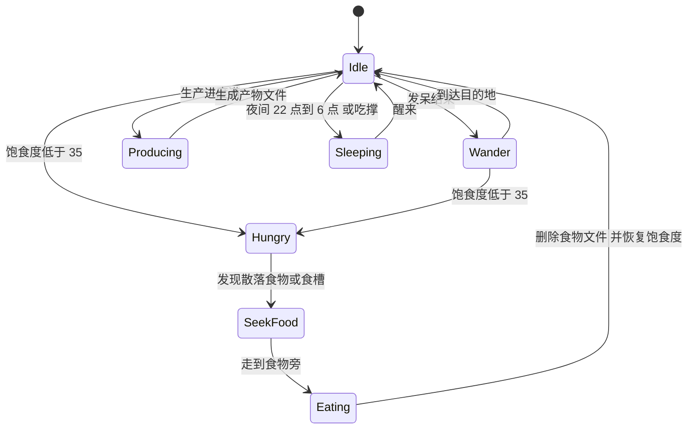
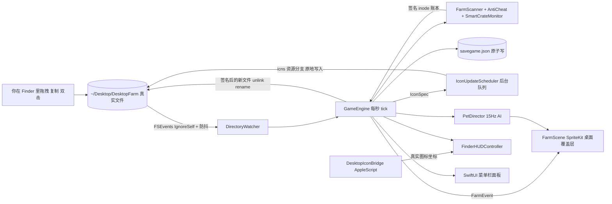

<div align="center">

# 🌾 DesktopHarvest · 桌面牧场

### Finder 即农场，文件即万物。
**一款原生 macOS 桌面农场 + 桌宠游戏：在真实的桌面文件夹里种菜、养动物、开工厂。**

[](#-快速开始)
[](#️-硬核架构与技术揭秘)
[](#️-硬核架构与技术揭秘)
[](#️-硬核架构与技术揭秘)
[](#-运行测试)
[](#-许可证)

[English](README_EN.md) | 简体中文

### [🌐 访问官方网站 (互动试玩)](https://patrick091210-arch.github.io/DesktopFarm/) · [📥 直接下载最新版 DMG](https://github.com/patrick091210-arch/DesktopFarm/releases/latest/download/DesktopHarvest.dmg) · [📦 查看所有 Releases](https://github.com/patrick091210-arch/DesktopFarm/releases)

</div>

---

<!--
  📸 媒体占位区：把录屏导出为 GIF / PNG 放进 docs/media/ 后，替换下面的占位链接即可。
  建议素材：
    hero.gif      桌面左下角菜园 + 散步的动物 + Finder 窗口里图标实时变化 + 加工机齿轮旋转（约 8 秒循环）
    clone.gif     Cmd+C / Cmd+V 复制一个苹果，1 秒后变成带裂纹的 🥀 克隆果
    factory.gif   把 2 个苹果拖进 ⚙️果酱加工机，文件夹图标出现进度环，完工后变成 ✨待收取
    panel.png     菜单栏 🌾 控制面板（农场 / 仓库 / 订单 / 商店 / 出货 / 设置）
-->

<div align="center">

| 🎬 主视觉 |
|:---:|
| `docs/media/hero.gif`（待补充）<br>*你的桌面活了：小鸡在 Dock 上方散步，苹果树在 Finder 里结果，果酱机的齿轮正在转动。* |

| 🥀 防作弊瞬间 | ⚙️ 文件夹工厂 | 🎛️ 菜单栏面板 |
|:---:|:---:|:---:|
| `docs/media/clone.gif`<br>*复制？它会当场枯萎。* | `docs/media/factory.gif`<br>*拖进去，等进度环转满。* | `docs/media/panel.png`<br>*状态栏一点即开。* |

</div>

---

## ✨ 为什么这个项目很酷？

- 📁 **真实文件系统就是游戏世界**
  种子 `.seed`、作物 `.crop`、果树 `.tree`、宠物 `.pet`、工具 `.tool`、产物 `.item`，全都是 `~/Desktop/DesktopFarm` 里的真实文件；木筐、加工机、出货箱则是真实文件夹。游戏没有单独的界面层：用 Finder 拖拽、双击、新建文件夹就是在玩。

- 🎨 **程序化图标实时重绘，不带任何图片素材**
  每个图标都由 CoreGraphics 现场绘制，再由 `IconWriter` 编码成 `icns`，原地写入文件的资源分支（Resource Fork）。所以你能看到：作物底部的水分条和生长条在涨，木筐越装越满，加工机文件夹每秒转一格齿轮、进度环一点点填满。

- 🐾 **两层画面：桌面覆盖层 + Finder HUD**
  桌面图标层之上（`desktopIconWindow + 1`）铺了一层透明的 SpriteKit 精灵层，菜园、动物和粒子特效都在这里。Finder 打开农场文件夹时，还会有一层 HUD 贴着窗口，把进度条和气泡画在真实图标上方。鼠标穿透以 30Hz 智能切换：只在动物、气泡或地块上方才拦截点击，其余时候点击照常落到你的桌面。

- 🛡️ **密码学 + inode 级防作弊**
  每个物品都带 `HMAC-SHA256` 签名，引擎同时追踪文件 inode。用 Finder 正常移动文件不受影响；但只要 `⌘C / ⌘V` 复制、手动改 JSON、或者把卖掉的物品备份拿回来，它就会立刻变成价值归零、图标带裂纹的 `🥀枯萎的克隆果`。

- 🎵 **音效全部在内存里实时合成**
  项目里没有一个音频文件。`SoundManager` 用正弦波、方波、噪声加滑音合成 16-bit WAV，涵盖浇水、收获、鸡叫、牛哞、羊咩、金币入账、机器完工、克隆碎裂等 15 种音效。

> [!TIP]
> 整个项目**零第三方依赖**，只用 Apple 官方框架：AppKit · SpriteKit · SwiftUI · CoreServices (FSEvents) · CryptoKit · ImageIO。Swift 6 strict concurrency 开到 `complete`，编译 0 个警告。

---

## 🎮 深度玩法指南

### 🌱 种植与果树

一年生作物（`.crop`）成熟后，**作物文件本身**会变成第一个果实 `.item`，再额外掉落剩余产量。多年生果树（`.tree`）则一直留在原地，每个结果周期在同一目录掉落 2~4 个果实，然后回到冷却期。

| 植物 | 类型 | 成熟 / 长成 | 结果周期 | 产量 | 种子价 | 解锁 |
|---|---|---|---|---|---|---|
| 🌾 小麦 | `.crop` | 90 秒 | — | 2–3 | 5 💰 | Lv.1 |
| 🌿 牧草 | `.crop` | 60 秒 | — | 3 | 3 💰 | Lv.1 |
| 🥕 胡萝卜 | `.crop` | 150 秒 | — | 2 | 8 💰 | Lv.2 |
| 🍓 草莓 | `.crop` | 240 秒 | — | 2–3 | 15 💰 | Lv.3 |
| 🍎 苹果树 | `.tree` | 300 秒 | 每 180 秒 | 2–4 | 60 💰 | Lv.1 |
| 🍒 樱桃树 | `.tree` | 420 秒 | 每 240 秒 | 2–4 | 120 💰 | Lv.4 |

生长阶段：作物是 `🌰 种子 → 🌱 幼苗 → 生长中 → 成熟`，果树是 `🌰 种子 → 🌿 树苗 → 🌳 大树（冷却）→ 🌳🍎 结果期`。
收获品质分**普通 / ★ 银星（售价 ×1.25）/ ★★ 金星（售价 ×1.5）**，由生长期间的平均水分决定。

### 💧 4 种浇水方式

植物只在**水分 > 15** 时生长。作物每秒失水 0.4，果树每秒失水 0.22；浇一次水 +50，上限 100。

| # | 方式 | 说明 |
|---|---|---|
| 1 | 🖱️ 拖到桌面地块上 | 把 `💧水壶.tool` 从 Finder 拖到桌面菜园的地块上 |
| 2 | 🪄 在 Finder 里靠近植物 | 在 Finder 图标视图里把水壶移到植物图标旁边，自动浇水，水壶随后自己回到原位 |
| 3 | 💬 点气泡 / 双击文件 | 点植物头顶的 💧 气泡，或者直接双击 `.crop` / `.tree` 文件 |
| 4 | ⚙️ 自动洒水器 | 在植物所在目录放一个 `⚙️自动洒水器.tool`，每秒补水 1.6，足以抵消失水 |

### 🐄 AI 桌宠与生态循环

动物在磁盘上是一个 `.pet` 锚点文件，在桌面上则是一只自由活动的 SpriteKit 精灵。删掉锚点文件，它就“回森林去了”。

| 动物 | 爱吃（饱食度 +） | 产出 | 生产周期 | 价格 | 解锁 |
|---|---|---|---|---|---|
| 🐔 小鸡 | 🌾45 · 🍎30 · 🍓30 | 🥚 鸡蛋 | 120 秒 | 40 💰 | Lv.1 |
| 🐑 绵羊 | 🌿45 · 🌾25 · 🍎25 · 🥕25 | 🧶 羊毛 | 200 秒 | 100 💰 | Lv.2 |
| 🐄 奶牛 | 🌿40 · 🌾35 · 🥕30 · 🍎25 | 🥛 牛奶 | 180 秒 | 120 💰 | Lv.3 |



- 饿了的动物移动变慢，头顶冒出最爱食物的气泡，会主动走向桌面上散落的食物，或者 `🥣动物食槽` 文件夹，然后**真的删除**那个食物文件。
- 喂食方式：把食物拖到动物身上；在面板里点「喂食」；右键动物；或者在食槽里囤一堆 `Wheat.item`，让它们按需取用。
- 好感度越高，产出越快、品质越好。点一下动物算抚摸，好感度 +1.5。

### ⚙️ 文件夹工厂与智能木筐

**加工机**：把原料拖进机器文件夹，凑齐配方就会自动开工。

| 机器 | 配方 | 耗时 | 价格 | 解锁 |
|---|---|---|---|---|
| ⚙️果酱加工机 | 2×🍎 → 🫙苹果酱（36）· 2×🍓 → 🍯草莓酱（60）· 2×🍒 → 🥫樱桃酱（54） | 20 秒 | 150 💰 | Lv.1 |
| ⚙️烘焙面包房 | 2×🌾 + 1×🥚 → 🎂农庄蛋糕（70） | 25 秒 | 250 💰 | Lv.3 |
| ⚙️乳品发酵桶 | 1×🥛 → 🧀香浓奶酪（45） | 20 秒 | 200 💰 | Lv.3 |
| ⚙️纺织机 | 1×🧶 → 🧥羊毛衫（65） | 15 秒 | 220 💰 | Lv.4 |

- 开工时原料被移入隐藏的 `.processing/` 子目录锁定，不能被卖掉，也不会被重复使用。
- 运转中，文件夹图标每秒刷新一次齿轮角度和 0→100% 的进度环，桌面层同步冒出蒸汽。完工时播放提示音，图标变成 **✨待收取**，成品直接出现在文件夹里。
- 即使中途崩溃、原料被手动拿走、或者 App 关了 3 天，机器都能自我修复：原料一件不丢，成品也不会重复产出。

**智能木筐**：`📦果蔬收集筐`、`📦牧场副产品筐`，以及任何名字含「筐」或 “crate” 的文件夹。

- 实时统计里面的物品，例如 `🍎苹果 x12 | 🥕胡萝卜 x5 | 🥛牛奶 x3`。
- 图标按装满程度变化：空筐 → 少量 → 半满 → 满满当当。
- 「一键整理桌面」会把散落的物品按类别归拢进对应的木筐。

### 💰 经济、订单与离线收益

| 系统 | 玩法 |
|---|---|
| 💰 出货箱 | 把任意 `.item` 拖进 `💰出货箱`，菜单栏实时显示待结算金额。点「立即出货」或等每天 0 点自动结算，每 8 金币额外获得 1 XP。 |
| 📋 订单板 | 同时有 3 位村民的订单（烘焙师玛莎、果园婆婆、裁缝艾米……），奖励为市价的 **1.5~1.9 倍**。物品放进 `📋订单交付箱` 或留在木筐里都会被计入，凑齐即可交付。订单 6 小时后过期，花 10 金币可以刷新。 |
| 🛒 商店 | 种子与树苗、动物幼崽、加工机文件夹、食槽（30）、自定义木筐（25）、水壶（10）、洒水器（120，Lv.2）。等级共 30 级，经验曲线为 `60 × (Lv−1)^1.55`。 |
| 🤖 收获小精灵 | Lv.4 解锁，300 💰。每 8 秒自动收获成熟作物，并把散落的果实收进木筐；它本身也会在菜园里巡逻。 |
| 🌙 离线收益 | 重新打开 App 时，把离开的时间（最长 72 小时，固定按 1× 速度）完整模拟一遍：先扣水分，再算生长、饥饿、从食槽进食、动物产出、机器完工。散落物品达到 24 个时，产出者自动暂停，不会刷满你的桌面。 |

<details>
<summary>🎁 新手农场里有什么？</summary>

初始 120 💰，外加：1 棵正在长大的苹果树、1 只叫「豆豆」的小鸡、2 包小麦种子 + 1 包牧草种子、`💧水壶.tool`、一台 `⚙️果酱加工机`、一个装着 2 份小麦的 `🥣动物食槽`，以及两个木筐、出货箱和订单交付箱。

</details>

---

## 🛠️ 硬核架构与技术揭秘

### 数据流



<details>
<summary>📂 源码结构（点击展开）</summary>

```text
DesktopFarm/
├── App/          DesktopHarvestApp(MenuBarExtra) · AppDelegate · GameCoordinator(组合根：把各模块串起来)
├── Model/        物品 / 作物 / 动物 / 机器配方 / 商店 / 等级曲线 · GameFile(磁盘 JSON) · GameState(存档)
├── Security/     ItemSigner — UUID + HMAC-SHA256，每台机器一个随机密钥
├── Persistence/  SaveManager — 原子写入 + 一份备份
├── FileSystem/   FarmSandbox(安全护栏) · FarmFileSystem · FarmScanner · DirectoryWatcher(FSEvents)
├── Engine/       GameEngine(+Files / +Actions / +Economy / +Queries) · BotanyHusbandryEngine
│                 SmartCrateMonitor(AntiCheat / 木筐 / 配方规划) · EconomyEngine · PetDirector(AI)
├── Rendering/    IconSpec · IconPainter · ProceduralIconRenderer · IconWriter · IconUpdateScheduler
├── Desktop/      DesktopOverlayWindow / Controller · FarmScene · SceneNodes · EffectFactory
│                 WorldLayout · DesktopIconBridge · FinderHUDController
├── Audio/        SoundManager — 内存合成 WAV
└── UI/           ControlPanelView + 农场 / 仓库 / 订单 / 商店 / 出货 / 设置 六个标签页
DesktopFarmTests/ 53 个 XCTest：安全加固、防作弊、模拟、恢复、经济、图标、性能护栏
```

</details>

<details>
<summary>🎨 为什么不用 <code>NSWorkspace.setIcon</code>？</summary>

我们实测发现，`setIcon` 每次调用都会先清除“有自定义图标”的标记，对文件夹还会**删除再重建**隐藏的 `Icon\r` 文件。图标一旦每秒刷新，Finder 就会闪烁，甚至停留在默认的蓝色文件夹图标上。而且每次调用会阻塞主线程约 200 毫秒。

`IconWriter` 的做法是：

1. 在后台队列用 CoreGraphics 画好图标，再用 ImageIO 编码成多尺寸 `icns`；
2. 手工拼出一个经典资源分支（只含一个 `'icns'` 资源，id 为 −16455），用一次 `setxattr` 原子替换 `com.apple.ResourceFork`；
3. “有自定义图标”的标记只设置、从不清除，文件夹的 `Icon\r` 只创建一次、之后一直复用；
4. 用 `lutimes` 更新文件夹的修改时间，让系统图标缓存刷新。

调度器会跳过视觉上相同的状态，进度条这类细微变化每 3 秒最多刷新一次，运转中的机器每秒刷新一次。图标如果被外部删掉，下一轮会自动补画。

</details>

<details>
<summary>🛡️ 防作弊是怎么判定的？</summary>

每个游戏文件只保存它的身份信息：`{format, id, kind, itemType, quality, timestamp, hmacSignature}`。生长、饥饿这类动态状态都在存档里。`AntiCheat.resolve` 的判定规则如下：

| 情况 | 结果 |
|---|---|
| HMAC 校验失败（改过 JSON、伪造、来自别人的电脑） | 🥀 克隆果 |
| UUID 已经卖出或消耗过 | 🥀 克隆果 |
| 签名合法但不在账本里，且时间戳早于上次存档 | 🥀 克隆果（被“复活”的备份） |
| 多个文件共用同一个 UUID | 与账本 inode 一致的是真品，其余全是克隆果 |
| Finder 移动（inode 不变）、移出农场后 30 天内放回 | ✅ 仍是真品 |

</details>

> [!IMPORTANT]
> **🔒 文件安全承诺：DesktopHarvest 绝不会动你的个人文件。**
>
> 任何删除、改写、重命名、移动操作，都必须先通过 `FarmSandbox.validateGameFile` 的 4 重校验：
> 1. **真实路径必须在农场内**：先解析符号链接，路径必须严格位于 `~/Desktop/DesktopFarm` 之内；
> 2. **拒绝符号链接和特殊文件**：用 `O_NOFOLLOW | O_NONBLOCK` 打开，再对同一个文件句柄 `fstat`，只接受普通文件，单个文件最多读 64 KB；
> 3. **严格的后缀白名单**：只认 `.seed` `.crop` `.tree` `.item` `.pet` `.tool`；
> 4. **格式头校验**：JSON 必须带 `"format": "DesktopHarvest/1"`。
>
> 真正删除前，还会再次核对文件身份（设备号 + inode），然后用 `unlink(2)` 删除。它**永远不会递归删除目录**，也不会顺着符号链接去删别的文件。重置时只删除合法的游戏文件和清理后已经变空的游戏文件夹；你放进农场目录的笔记、照片、隐藏文件都会原封不动。以上每一条都有单元测试覆盖，包括 4 GB 稀疏文件、命名管道（FIFO）陷阱，以及“校验通过后文件被偷换成目录”的竞态场景。

---

## 📦 下载与安装 (Installation)

1. 前往 [GitHub Releases](https://github.com/patrick091210-arch/DesktopFarm/releases) 下载最新版本的 **`DesktopHarvest-v1.0.0.dmg`** 安装包（Universal Binary，原生支持 Apple Silicon `arm64` 与 Intel `x86_64`）。
2. 双击挂载 `.dmg` 镜像，在弹出的窗口中将 **`DesktopHarvest.app`** 拖入右侧的 **`Applications`（应用程序）** 文件夹。
3. 启动应用后，请查看屏幕右上角菜单栏的 **`🌾 120`** 图标（点击即可打开农场控制台）。

> [!IMPORTANT]
> **首次打开若提示「无法验证开发者」或「已损坏」？**  
> 由于本项目采用本地 Ad-hoc 签名分发且未交纳 Apple 开发者年费公证，首次从浏览器下载打开若遇到 macOS Gatekeeper 拦截，请在终端运行以下命令解除隔离属性：
> ```bash
> sudo xattr -rd com.apple.quarantine /Applications/DesktopHarvest.app
> ```
> 执行后即可直接双击打开，或按住 `Control` 键右键点击应用图标选择「打开」。

---

## 🚀 快速开始（从源码构建 & 打包 DMG）

**环境要求**：macOS 14.0+，安装了 Xcode（Swift 6，macOS SDK）。不需要任何包管理器。

```bash
git clone https://github.com/patrick091210-arch/DesktopFarm.git && cd DesktopFarm

# 如果 xcode-select 指向的是 Command Line Tools，需要加上这一行
export DEVELOPER_DIR=/Applications/Xcode.app/Contents/Developer

# 构建 Debug 版并直接运行
xcodebuild -project DesktopFarm.xcodeproj -scheme DesktopFarm \
  -configuration Debug -derivedDataPath .build/DerivedData build
open .build/DerivedData/Build/Products/Debug/DesktopHarvest.app

# 一键构建 Release 通用二进制并打包 dist/DesktopHarvest-v1.0.0.dmg
bash scripts/package_dmg.sh
```

### 🧪 运行测试

```bash
xcodebuild -project DesktopFarm.xcodeproj -scheme DesktopFarm \
  -configuration Debug -derivedDataPath .build/DerivedData test
# → Executed 53 tests, with 0 failures
```

所有测试都在独立的临时目录里运行，永远不会碰你真实的桌面。

### 🔑 首次启动

- **在菜单栏找 🌾**：这是一个菜单栏程序（`LSUIElement`），没有 Dock 图标，也没有主窗口。点状态栏的 `🌾 120`（数字是你的金币数）打开控制面板。
- **桌面文件夹访问权限**：首次运行时 macOS 会询问，允许后游戏才能创建 `~/Desktop/DesktopFarm`。
- **自动化 → Finder**（可选）：允许后，特效和进度条会精准悬浮在 Finder 窗口里的真实图标上方。
  拒绝也没关系，游戏会平滑降级为桌面网格坐标模式，玩法完全不受影响。

> [!TIP]
> 想快速体验？在「设置 → 游戏速度」里选 **20×**，小麦几秒就成熟。离线收益固定按 1× 结算，不会因为你开着加速就多算。

### 🧑‍💻 开发者环境变量

| 变量 | 作用 |
|---|---|
| `DESKTOP_HARVEST_ROOT` | 指定农场目录（默认 `~/Desktop/DesktopFarm`） |
| `DESKTOP_HARVEST_SUPPORT` | 指定存档与签名密钥目录（默认 `~/Library/Application Support/DesktopHarvest`） |

```bash
# 在临时目录里放心折腾，不碰真实桌面
DESKTOP_HARVEST_ROOT=/tmp/dh/DesktopFarm DESKTOP_HARVEST_SUPPORT=/tmp/dh/Support \
  .build/DerivedData/Build/Products/Debug/DesktopHarvest.app/Contents/MacOS/DesktopHarvest
```

> [!WARNING]
> 存档目录里的 `signing.key` 是物品签名的根密钥。只删存档、保留密钥没有问题；但如果单独删掉密钥，所有已有物品都会被判定为伪造。

---

## 📌 已知限制与路线图

**已知限制**

- 🧭 Finder 图标坐标是估算的：标题栏高度 + 侧边栏宽度 + AppleScript 返回的 `position`。窗口滚动后无法拿到偏移量，所以 HUD 只装饰仍在可见区域内的图标。
- 🖥️ 桌面菜园固定排在主屏幕左下角，最多 9 列；动物在各自所在屏幕的下部活动。
- ✍️ 目前是 Ad-hoc 签名，没有启用 App Sandbox，也没有公证，首次打开需要在「隐私与安全性」里放行。
- 👀 桌面覆盖层的视觉效果和多显示器表现，还缺少带屏幕录制的系统化验证。

**路线图（欢迎认领 🙌）**

- 🌦️ **天气与季节**：根据系统时间和天气切换季节作物，下雨天自动浇水，覆盖层飘雨雪粒子。
- 🤝 **iCloud 农场串门**：沿用现有的签名机制，在两台 Mac 之间安全地“赠送”物品文件，接收方校验签名后收下。
- 🧩 **Mod 化配方**：把作物、动物、配方表外置成可签名的 JSON 数据包，社区可以自制新机器。
- ⌨️ **快捷指令 / App Intents**：用 Siri 或 Shortcuts 完成“给所有作物浇水”“出货”。

---

## 📄 许可证

仓库目前还**没有**选定许可证（因此显示为 `TBD`）。在添加 `LICENSE` 文件之前，代码默认保留所有权利；如果你想贡献代码或二次分发，请先开 Issue 讨论。所有图标都是运行时程序化绘制的，音效是内存合成的，项目中**不包含任何第三方美术或音频素材**。

<div align="center">

**Made with 🌾 and a lot of `stat(2)` calls.**

</div>
