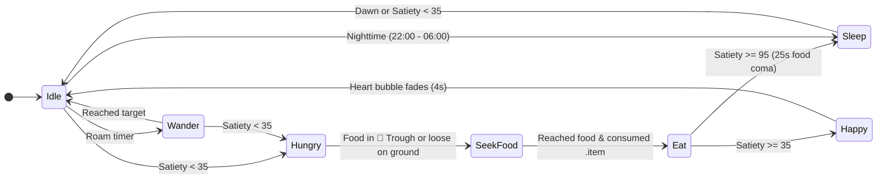
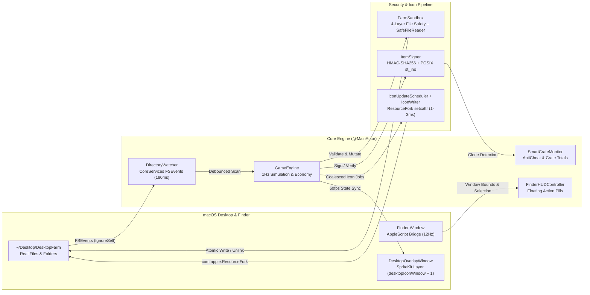

<div align="center">

# 🌾 DesktopHarvest · 桌面牧场

**Finder is your farm. Every file is alive.**  
*A native macOS desktop farming & virtual pet game where crops, fruit trees, animals, and factory machines live as real files and folders inside `~/Desktop/DesktopFarm`.*

[](#)
[](#)
[](#)
[](#)
[](#)
[](#license)

**English | [简体中文](README.md)**

</div>

---

<!-- =========================================================================
     Media Placeholders: Drop recorded GIFs / screenshots into docs/media/
     Recommended capture tool: CleanShot X or Kap (60fps, 1280×800)
     ========================================================================= -->

<div align="center">

| 🖥️ Desktop Garden & Roaming Pets | 🧪 Finder Copy Anti-Cheat (Withered Clone) |
| :---: | :---: |
| <br><sub>*Bottom-left desktop plot with live growth rings, rain particles, and roaming SpriteKit pets*</sub> | <br><sub>*Pressing ⌘D or Option-dragging an `.item` in Finder immediately turns the duplicate into a 0-coin `🥀 Withered Clone`*</sub> |
| ⚙️ Folder Factories & Live Resource Fork Icons | 🎛️ Menu Bar Control Panel (`🌾`) |
| <br><sub>*Drag apples into `⚙️果酱加工机`—watch the folder icon spin its gear at 1 Hz and pop out `🫙苹果酱.item`*</sub> | <br><sub>*Native SwiftUI popover for the Shop, Order Board, Encyclopedia, Activity Log, and time-scale controls*</sub> |

</div>

---

## ✨ Why DesktopHarvest? (Core Highlights)

- 📁 **The Real Filesystem *Is* the Game World**: Every seed (`.seed`), crop (`.crop`), fruit tree (`.tree`), pet (`.pet`), tool (`.tool`), and harvest (`.item`) is a genuine JSON-backed file on disk; every trough, factory machine, crate, and shipping bin is a real Finder folder inside `~/Desktop/DesktopFarm`. Plant by double-clicking, feed by dragging, and automate by moving files in Finder.
- 🎨 **Flicker-Free Procedural Resource Fork Icons**: Zero bundled image assets. `IconRenderService` draws multi-layer vector sprites with `CoreGraphics`, and `IconWriter` writes canonical `.icns` (`ic07` / `ic08` / `ic09`) directly into the `com.apple.ResourceFork` extended attribute (`setxattr`) and `com.apple.FinderInfo` in ~1–3 ms—updating folder gears, moisture bars, and crate fill levels at 1 Hz without triggering Finder's default blue-folder fallback.
- 🐾 **Dual-Layer Spatial Fusion (Desktop Overlay + Finder HUD)**: A borderless transparent `NSPanel` anchored at `CGWindowLevelForKey(.desktopIconWindow) + 1` renders autonomous SpriteKit pets, rain particles, and speech bubbles right over your wallpaper, while a companion HUD tracks the frontmost Finder window at 12 Hz. A 30 Hz hit-test loop (`updateMousePassthrough`) toggles `ignoresMouseEvents` only when your cursor hovers over an interactive sprite or plot.
- 🛡️ **Cryptographic + POSIX Inode Anti-Cheat**: Every `.item` file carries an `HMAC-SHA256` signature (key stored in `0600`-permission app support storage) and is bound to its POSIX `st_ino` inode number. Moving a file in Finder preserves its inode and value; duplicating it (`⌘C`/`⌘V`, `⌘D`, or Option-drag) creates a new inode with the same UUID, which `SmartCrateMonitor` immediately downgrades in-place into a worthless `🥀枯萎的克隆果.item` (Withered Clone).
- 🔊 **Pure In-Memory WAV Sound Synthesis**: `SoundManager` synthesizes 16-bit 44.1 kHz PCM waveforms with ADSR envelopes and multi-note arpeggios in memory—delivering crisp feedback for watering, harvesting, feeding, coin payouts, and level-ups with zero audio asset files.

---

## 🎮 Gameplay Systems

### 1. 🌱 Botany & Perennial Orchards

Buy `.seed` files from the menu bar shop (`🌾`) or plant directly onto the 8 desktop soil plots. Plants grow only while **Moisture > 15%** (max `100%`, `+50%` per watering). Each harvested `.item` rolls a quality tier: **Normal (`1.0×`)**, **Silver (`★ 1.25×`)**, or **Gold (`★★ 1.5×`)**.

| Plant | Type & Ext | Growth Cycle | Moisture Drain | Yield & Base Value | Shop Cost & Unlock |
| :--- | :--- | :--- | :--- | :--- | :--- |
| 🌾 **Wheat** (`Wheat`) | Annual `.crop` | `90s` (`🌱 → 🌿 → 🌾`) | `0.40 / s` | `2–3× 🌾小麦.item` (`4` coins · `3 XP`) | `5` coins · Lv.1 |
| 🌿 **Hay** (`Hay`) | Annual `.crop` | `60s` (`🌱 → 🌿 → 🌾`) | `0.40 / s` | `3× 🌿牧草.item` (`2` coins · `1 XP`) | `3` coins · Lv.1 |
| 🥕 **Carrot** (`Carrot`) | Annual `.crop` | `150s` (`🌱 → 🌿 → 🥕`) | `0.40 / s` | `2× 🥕胡萝卜.item` (`9` coins · `4 XP`) | `8` coins · Lv.2 |
| 🍓 **Strawberry** (`Strawberry`) | Annual `.crop` | `240s` (`🌱 → 🌿 → 🍓`) | `0.40 / s` | `2–3× 🍓草莓.item` (`14` coins · `6 XP`) | `15` coins · Lv.3 |
| 🍎 **Apple Tree** (`AppleTree`) | Perennial `.tree` | `300s` to mature, fruits every `180s` | `0.22 / s` | Drops `2–4× 🍎苹果.item` (`8` coins · `3 XP`), reverts to `🌳` | `60` coins · Lv.1 |
| 🍒 **Cherry Tree** (`CherryTree`) | Perennial `.tree` | `420s` to mature, fruits every `240s` | `0.22 / s` | Drops `2–4× 🍒樱桃.item` (`12` coins · `4 XP`), reverts to `🌳` | `120` coins · Lv.4 |

**4 Ways to Water Your Crops**:
1. **Desktop Soil Ring / Speech Bubble**: Hover over any desktop plot or dry plant bubble (`💧缺水`) and click directly on the wallpaper.
2. **Finder HUD Pill**: Open `~/Desktop/DesktopFarm` in Finder and click the floating `💧浇水` / `✨收获` buttons tracked over each file row or icon.
3. **Double-Click in Finder**: Double-click any `.seed`, `.crop`, `.tree`, or `💧水壶.tool` (`10` coins, waters every dry plant at once).
4. **Automated Sprinkler**: Place `⚙️自动洒水器.tool` (`120` coins, Lv.2) anywhere in the farm folder to continuously restore `+1.6 / s` moisture to all plants.

---

### 2. 🐔 Autonomous AI Desktop Pets

Each `.pet` file spawns a living `AnimalNode` on your desktop overlay and participates in Finder folder interactions:

| Species | Diet & Satiety Gain (★ = Favorite) | Output & Base Value | Cycle & Hunger Drain | Shop Cost & Unlock |
| :--- | :--- | :--- | :--- | :--- |
| 🐔 **Chicken** (`Chicken`) | ★ `🌾 Wheat (+45)` · `🍎 Apple (+30)` · `🍓 Strawberry (+30)` | `🥚鸡蛋.item` (`10` coins · `4 XP`) | `120s` · `-0.15 / s` | `40` coins · Lv.1 |
| 🐑 **Sheep** (`Sheep`) | ★ `🌿 Hay (+45)` · `🌾 Wheat (+25)` · `🍎 Apple (+25)` · `🥕 Carrot (+25)` | `🧶羊毛.item` (`22` coins · `6 XP`) | `200s` · `-0.11 / s` | `100` coins · Lv.2 |
| 🐄 **Cow** (`Cow`) | ★ `🌿 Hay (+40)` · `🌾 Wheat (+35)` · `🥕 Carrot (+30)` · `🍎 Apple (+25)` | `🥛牛奶.item` (`18` coins · `6 XP`) | `180s` · `-0.12 / s` | `120` coins · Lv.3 |



- **Two Ways to Feed**: Drop edible `.item` files into the `🥣动物食槽` (Animal Trough) folder for automatic consumption when `Satiety < 35`, or drag a food file from Finder and drop it onto a roaming pet on your desktop.
- **Interactive Petting**: Click any desktop pet to trigger a bounce animation, floating `❤️` particles, and `+1.5` affection (higher affection boosts Silver/Gold byproduct odds).

---

### 3. ⚙️ Folder Factories & Smart Crates

Drag raw `.item` files into any `⚙️` machine folder inside `~/Desktop/DesktopFarm`. The engine moves the inputs into a hidden `.processing/` subdirectory (preventing mid-job theft), rotates the folder's custom gear icon & progress arc every second, and emits the finished product (+`10 XP`) when complete:

| Machine Folder | Recipe Input → Output | Base Sell Value | Craft Time | Shop Cost & Unlock |
| :--- | :--- | :--- | :--- | :--- |
| `⚙️果酱加工机` (Jam Maker) | `2× 🍎 Apple` → `🫙苹果酱.item`<br>`2× 🍓 Strawberry` → `🍯草莓酱.item`<br>`2× 🍒 Cherry` → `🥫樱桃酱.item` | `36` coins<br>`60` coins<br>`54` coins | `20s` | `150` coins · Lv.1 |
| `⚙️烘焙面包房` (Bakery) | `2× 🌾 Wheat + 1× 🥚 Egg` → `🎂蛋糕.item` | `70` coins | `25s` | `250` coins · Lv.3 |
| `⚙️乳品发酵桶` (Dairy) | `1× 🥛 Milk` → `🧀奶酪.item` | `45` coins | `20s` | `200` coins · Lv.3 |
| `⚙️纺织机` (Loom) | `1× 🧶 Wool` → `🧥毛衣.item` | `65` coins | `15s` | `220` coins · Lv.4 |

- **📦 Smart Crates (`📦果蔬收集筐`, `📦牧场副产品筐`, or any `📦...` folder)**: Driven by `FSEvents`, `SmartCrateMonitor` inspects every `.item` inside, aggregates total quantity and coin value, and redraws the folder's wooden crate icon (empty / half-full / overflowing with a coin badge).

---

### 4. 💰 Economy, Order Board & Automation

- **💰 Shipping Bin (`💰出货箱`)**: Drop any valid `.item` (or a whole stack) into `💰出货箱` to immediately liquidate it for coins (`baseValue × qualityMultiplier`) and shipping XP (`coins / 8`).
- **📋 Order Delivery Box (`📋订单交付箱`)**: 3 rotating NPC orders offer a **1.5×–1.9× coin & XP premium** (6-hour expiry, 45s auto-respawn, or manual refresh for `10` coins). Partial deliveries are persisted across sessions.
- **🤖 Harvest Sprite (`🤖收获小精灵`, `300` coins, Lv.4)**: Every `8s`, automatically harvests mature crops/trees and routes loose farm outputs into `📦果蔬收集筐` and `📦牧场副产品筐`.
- **⏳ 72-Hour Offline Progression & Loose-Item Cap**: On launch, `applyOfflineProgress` simulates up to 72 hours of elapsed real time at `1×` speed. To protect your filesystem from runaway file creation, any folder holding `24` loose `.item` files (`GameEngine.looseItemCap`) pauses further drops until cleared.

---

## 🏗️ Architecture & Under the Hood

### System Dataflow



<details>
<summary>📂 <b>Project Structure (Click to expand)</b></summary>

```text
DesktopFarm/
├── App/
│   ├── main.swift                   # Explicit NSApplication entry point
│   └── AppDelegate.swift            # Menu bar status item (🌾), NSPopover, overlay & HUD lifecycle
├── Model/
│   ├── GameTypes.swift              # Core models: PlantState, PetState, FarmItemDocument, ActiveMachineJob
│   ├── ItemCatalog.swift            # 16 item definitions, prices, XP rewards, quality multipliers
│   ├── PlantCatalog.swift           # 4 annual crops + 2 perennial fruit trees & growth stages
│   ├── AnimalMachineCatalog.swift   # 3 pet species, 4 folder machines, recipes & unlock levels
│   └── Progression.swift            # SaveGame schema, XP curve (Lv.1–30), NPC OrderGenerator
├── FileSystem/
│   ├── FarmSandbox.swift            # 4-layer file validation, SafeFileReader (256KB cap), POSIX unlink
│   ├── FarmFileSystem.swift         # Atomic JSON read/write, safe rename (renamex_np), folder scanner
│   └── DirectoryWatcher.swift       # Latency-coalesced FSEvents stream (IgnoreSelf + FileEvents)
├── Security/
│   └── ItemSigner.swift             # HMAC-SHA256 signer & AntiCheat.resolve (UUID + st_ino + spentIDs)
├── Rendering/
│   ├── IconRenderService.swift      # CoreGraphics procedural vector renderer + NSCache
│   ├── IconWriter.swift             # Direct ResourceFork ('icns') & FinderInfo writer via setxattr
│   └── IconUpdateScheduler.swift    # Coalesced background queue (max 4 concurrent jobs, 150ms throttle)
├── Engine/
│   ├── GameEngine.swift             # 1Hz master loop, 72h offline catch-up, shop, orders & automation
│   ├── SmartCrateMonitor.swift      # Crate valuation, anti-cheat enforcement & shipping bin payout
│   └── SoundManager.swift           # Pure in-memory 16-bit PCM WAV synthesizer
├── Bridge/
│   ├── FinderBridge.swift           # AppleScript bridge for Finder window bounds & icon coordinates
│   └── FinderHUDController.swift    # Floating SwiftUI action pills tracking active Finder windows
├── Overlay/
│   ├── DesktopOverlayWindow.swift   # Multi-screen transparent NSPanel + 30Hz mouse passthrough
│   └── DesktopOverlayScene.swift    # SpriteKit scene: soil plots, roaming AnimalNodes, weather & particles
├── UI/
│   └── ControlPanelView.swift       # Menu bar SwiftUI dashboard (Overview, Shop, Orders, Guide, Logs)
└── Resources/
    └── Info.plist                   # LSUIElement agent config, document UTIs & Automation usage string
```

</details>

<details>
<summary>🎨 <b>Deep Dive 1: Why custom <code>IconWriter</code> instead of <code>NSWorkspace.shared.setIcon</code>?</b></summary>

When updating custom folder and file icons at `1 Hz` (or `20×` debug speed), AppKit's `NSWorkspace.shared.setIcon(_:forFile:)` exhibits two severe flaws:
1. **Blue Folder Reversion Race**: For directories, `setIcon` deletes and recreates the hidden `Icon\r` file on every call. Under rapid updates, Finder catches the folder mid-transition and reverts it to the default macOS blue folder icon.
2. **Tree Icon Flicker & Main-Thread Stalls**: For regular files, `setIcon` clears `kHasCustomIcon` in `com.apple.FinderInfo` before rewriting the resource fork and takes ~150–250 ms synchronously.

**Our Solution (`IconWriter.swift` + `IconUpdateScheduler.swift`)**:
- Builds a minimal Apple Icon Image (`icns`) container in memory (`ic07` 128px, `ic08` 256px, `ic09` 512px PNG payloads) wrapped in a canonical 286-byte `com.apple.ResourceFork` header (`'icns'` resource ID `-16455`).
- Calls `setxattr(path, "com.apple.ResourceFork", ...)` atomically in-place—reusing existing `Icon\r` files inside folders without ever unlinking them—and sets `kHasCustomIcon` (`0x0400`) + `kIsInvisible` (`0x4000`) via a 32-byte `com.apple.FinderInfo` write.
- Nudges Finder to repaint via `lutimes(2)` on the target without creating temporary probe files (which would otherwise feedback-loop into `FSEvents`), completing each icon update in **1–3 ms** on a throttled background queue.

</details>

<details>
<summary>🛡️ <b>Deep Dive 2: How does <code>ItemSigner</code> + POSIX <code>st_ino</code> stop Finder file duplication?</b></summary>

Because every harvestable `.item` is an ordinary JSON file on disk, a curious player might try copying files (`⌘C`/`⌘V`, `⌘D`, or Option-dragging) or editing JSON values in a text editor. `AntiCheat.resolve` closes every loophole:
1. **Cryptographic Integrity (`HMAC-SHA256`)**: Each `FarmItemDocument` signs `id|itemType|quality|timestampMillis` using a 256-bit secret key stored at `~/Library/Application Support/DesktopHarvest/.secret_key` (`0600` permissions). Editing `itemType` or `quality` in a text editor invalidates the MAC.
2. **Move vs. Copy Detection via Inode (`st_ino`)**: Moving a file across folders on the same APFS volume preserves its POSIX inode (`stat.st_ino`). Copying a file allocates a **brand-new inode** while retaining the same JSON `id` (UUID). When `SmartCrateMonitor` sees a known UUID on a second live inode, the new copy is flagged as `.clonedCopy`.
3. **Anti-Resurrection (`spentItemIDs` + `registeredWindow`)**: Sold, fed, and crafted UUIDs are recorded in a bounded FIFO ring buffer (`10,000` IDs), and any unregistered UUID carrying a creation timestamp older than the last save window (`createdAt ... lastSavedAt - 5s`) is rejected—preventing players from restoring backed-up `.item` files after selling them.
4. **In-Place Withered Downgrade**: Detected clones or tampered files are rewritten in-place as `🥀枯萎的克隆果.item` (`witheredClone`, worth `0` coins) with a custom wilted icon.

</details>

> [!IMPORTANT]
> **4-Layer Filesystem Safety Guarantee (`FarmSandbox.validateGameFile`)**  
> DesktopHarvest **never** touches personal files on your Desktop. Every file modification, rename, or deletion must pass all four checks in `FarmSandbox.validateGameFile`:
> 1. **Canonical Boundary Check**: Resolves symlinks (`resolvingSymlinksInPath`) and verifies the real path is strictly inside `~/Desktop/DesktopFarm/`.
> 2. **POSIX Descriptor Verification (`SafeFileReader`)**: Opens the file with `O_RDONLY | O_NOFOLLOW | O_NONBLOCK`, runs `fstat(2)` to reject symlinks, FIFOs, sockets, and device nodes, and enforces a hard **256 KB size ceiling** before reading a single byte into memory.
> 3. **Extension Whitelist**: Only `.seed`, `.crop`, `.tree`, `.item`, `.pet`, and `.tool` extensions are permitted.
> 4. **Magic Header Signature**: The JSON payload must contain `"format": "DesktopHarvest/1"`. Furthermore, deletions use raw POSIX `unlink(2)` (which refuses directories at the kernel level) and renames use `renamex_np(..., RENAME_EXCL)` to prevent overwriting user files.

---

## 🚀 Quick Start & Building

### Requirements
- **macOS 14.0 (Sonoma)** or later
- **Xcode 16.0+** with Swift 6 toolchain (`Apple Swift version 6.0+`)
- Zero external dependencies (no CocoaPods, no external SwiftPM packages, no Homebrew tools required)

### Build & Run from Terminal

```bash
# 1. Clone the repository
git clone https://github.com/patrick091210-arch/DesktopFarm.git
cd DesktopFarm

# 2. Build the Debug app bundle
DEVELOPER_DIR=/Applications/Xcode.app/Contents/Developer \
  xcodebuild -project DesktopFarm.xcodeproj \
  -scheme DesktopFarm \
  -configuration Debug \
  -derivedDataPath .build/DerivedData \
  build

# 3. Launch DesktopHarvest.app
open .build/DerivedData/Build/Products/Debug/DesktopHarvest.app
```

### Run the 53 Automated Unit Tests (Isolated Sandbox)

All 53 unit tests run inside temporary directories via `DESKTOP_HARVEST_ROOT` and `DESKTOP_HARVEST_SUPPORT` and **never touch your real `~/Desktop`**:

```bash
DEVELOPER_DIR=/Applications/Xcode.app/Contents/Developer \
  xcodebuild -project DesktopFarm.xcodeproj \
  -scheme DesktopFarm \
  -configuration Debug \
  -derivedDataPath .build/DerivedData \
  test
```

### First-Run Permissions & Controls
1. **Menu Bar Icon (`🌾`)**: DesktopHarvest runs as a menu bar agent (`LSUIElement = true`, no Dock clutter). Click `🌾` in the top-right menu bar to open the control panel, or right-click for quick actions.
2. **Desktop Folder Access**: On first launch, macOS will prompt for permission to access your Desktop folder so the game can create `~/Desktop/DesktopFarm`.
3. **Automation → Finder (Optional)**: Granting Finder Automation permission enables the floating Finder HUD pills (`💧浇水` / `✨收获`). Even without it, desktop overlay interactions, double-clicking files, and folder drag-and-drop work at 100%.

### Environment Variables for Debugging & Isolated Sandboxes

| Variable | Purpose | Default |
| :--- | :--- | :--- |
| `DESKTOP_HARVEST_ROOT` | Override the farm root directory (ideal for testing or keeping the farm outside `~/Desktop`) | `~/Desktop/DesktopFarm` |
| `DESKTOP_HARVEST_SUPPORT` | Override the save-file and HMAC key directory | `~/Library/Application Support/DesktopHarvest` |

---

## 🗺️ Known Limitations & Roadmap

### Current Known Limitations
- **Finder Scroll Offset Estimation**: Because Finder's AppleScript dictionary does not expose internal scroll-view offsets, `FinderHUDController` estimates item rows within the visible window bounds. Keep `~/Desktop/DesktopFarm` in Icon View or an un-scrolled List View for pixel-perfect HUD alignment.
- **Primary Screen Garden Layout**: The transparent overlay spans all connected displays, while the 8 soil plots are anchored to the bottom-left corner of the primary display (`NSScreen.main`).
- **Ad-Hoc Local Code Signature**: Local builds use ad-hoc signing (`CODE_SIGN_IDENTITY = "-"`). If macOS resets TCC permissions after a rebuild, toggle DesktopHarvest in `System Settings → Privacy & Security → Automation`.

### Roadmap Ideas
- [ ] **Weather & Seasonal Cycles**: Dynamic rainstorms that auto-water desktop plots and seasonal crops (Pumpkins in Autumn, Snowberries in Winter).
- [ ] **iCloud Drive Multi-Mac Pasture**: Sync pet states and rare heirloom seeds across Macs while preserving per-device inode anti-cheat tokens.
- [ ] **Custom Shader & Sprite Packs**: Load community JSON/SVG themes for pets and crops while keeping the procedural fallback renderer.
- [ ] **Desktop Fishing Pond (`.pond` folder)**: Drop bait into a desktop pond folder and reel in animated fish catches on the wallpaper overlay.

---

## 📄 License

Released under the **MIT License**. Built with ❤️ and pure Swift 6 for macOS tinkerers and cozy game lovers.
